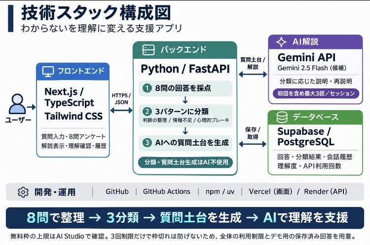

<p align="center">
  
</p>

<h3 align="center">わかるが、次の一歩の力になる。</h3>

---

## ITOGUCHI（イトグチ）とは

**「わからない」を「理解」に変える支援アプリ**です。

いまの生成AIは、質問には答えてくれます。でも、その人が**なぜ**わからないのかまでは考えてくれません。
ITOGUCHIは、まず「わからない原因」を分析し、その原因に合った説明をAIに頼むことで、理解までの糸口をつくります。

```
8問で整理 → 3分類 → 質問土台を生成 → AIで理解を支援
```

| つまずきタイプ | 状態 | AIの役割 |
|---|---|---|
| 判断の整理 | 情報はあるが決められない | 選択肢の整理、比較、優先順位付け |
| 情報不足 | 知識や用語が足りない | 知識の補完、用語説明、具体例の提示 |
| 心理的ブレーキ | 失敗が不安、自信がない | 不安の整理、小さな行動の支援 |

> 分類と質問土台の生成はルールベース（Python）で行い、**AIは使いません**。AI（Gemini）は解説と再説明だけを担当します（1セッション最大3回）。

## 技術スタック



| 領域 | 技術 |
|---|---|
| フロントエンド | Next.js / TypeScript / Tailwind CSS（`frontend/`） |
| バックエンド | Python / FastAPI（`backend/`） |
| AI | Gemini 2.5 Flash |
| DB | Supabase（PostgreSQL） |
| 開発・運用 | GitHub / GitHub Actions / npm / uv / Vercel（画面）/ Render（API） |

## ディレクトリ構成

```
hackathon_ito/
├─ frontend/                Next.js アプリ
│  └─ src/
│     ├─ app/page.tsx       画面（入力 → アンケート → 解説 → 理解度確認）
│     └─ lib/               API呼び出し・質問文
├─ backend/                 FastAPI アプリ
│  ├─ app/
│  │  ├─ main.py            APIエンドポイント
│  │  ├─ classifier.py      8問の採点と3分類
│  │  ├─ prompt_builder.py  質問土台・プロンプト生成
│  │  └─ gemini.py          Gemini API 呼び出し
│  └─ tests/
├─ docs/
│  └─ specification.md      要件定義書・仕様書（MVP）
└─ .github/workflows/ci.yml
```

## セットアップ

必要なもの: [Node.js](https://nodejs.org/) 20以上、[uv](https://docs.astral.sh/uv/)

```bash
git clone https://github.com/2611062h-Kiichi/hackathon_ito.git
cd hackathon_ito
```

**バックエンド**（ターミナル1）

```bash
cd backend
uv sync
cp .env.example .env      # GEMINI_API_KEY を設定（未設定ならデモ文が返る）
uv run uvicorn app.main:app --reload
```

→ http://localhost:8000/docs でAPIを試せます。

**フロントエンド**（ターミナル2）

```bash
cd frontend
npm install
cp .env.example .env.local
npm run dev
```

→ http://localhost:3000 を開く。

Gemini APIキーは [Google AI Studio](https://aistudio.google.com/apikey) で取得できます。**`.env` は絶対にコミットしないでください。**

## 開発の進め方

1. `main` から作業ブランチを切る（例: `feat/survey-ui`、`fix/classify-tie`）
2. こまめにコミットしてプッシュする
3. Pull Request を作成する（CIが通ったらマージ）

```bash
git switch main && git pull
git switch -c feat/xxx
# ...作業...
git add . && git commit -m "アンケート画面を作成"
git push -u origin feat/xxx
```

## MVPのTODO

- [x] わからない内容の入力
- [x] 8問アンケート
- [x] 3分類（ルールベース）
- [x] AI質問土台の生成
- [x] Gemini による解説
- [x] 理解度の入力（5段階）
- [x] 最大3回の再説明
- [ ] 履歴の保存（Supabase）
- [ ] AI利用回数のサーバー側管理（セッションID）
- [ ] 全体の利用制限・デモ用の保存済み回答
- [ ] デプロイ（Vercel / Render）

詳細は [docs/specification.md](docs/specification.md) を参照してください。
